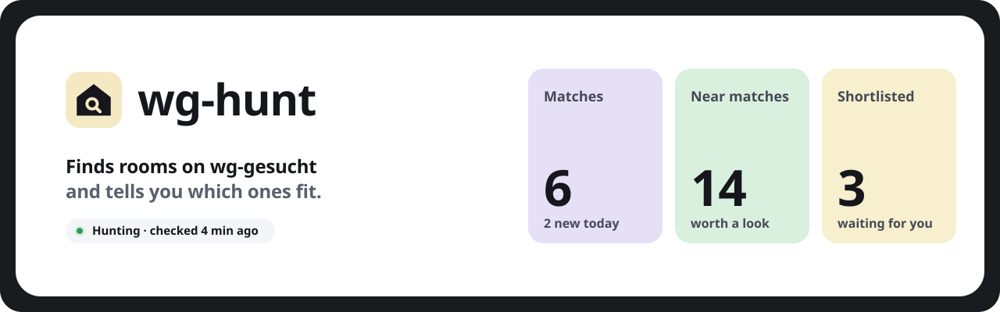
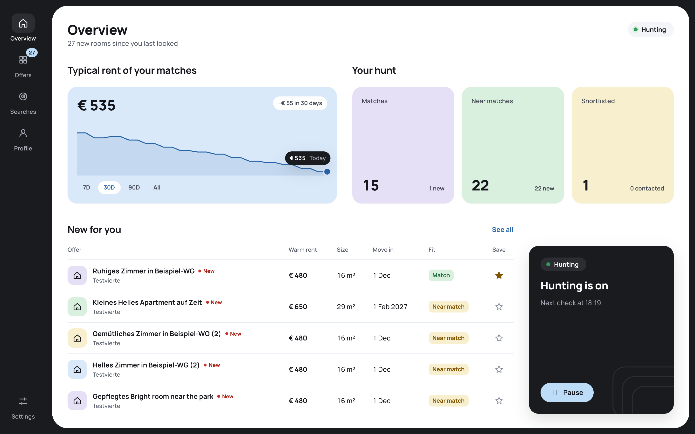

<picture>
  <source media="(prefers-color-scheme: dark)" srcset="docs/assets/banner-dark.svg">
  
</picture>

<br>

wg-hunt is a self-hosted app that watches [wg-gesucht.de](https://www.wg-gesucht.de) for new rooms and sorts them by how well they fit you, with the reason for each.

<picture>
  <source media="(prefers-color-scheme: dark)" srcset="docs/assets/overview-dark.png">
  
</picture>

## Quick start

You need Docker with Compose. Run it on a machine that stays on.

```sh
git clone https://github.com/ncwn/wg-hunt.git
cd wg-hunt
docker compose up -d
cat .data/access-token
```

Open <http://127.0.0.1:8787> and sign in with the token.

## Set it up

1. **Profile:** your budget, move-in date and what you need. **Load example** gives you a starting point.
2. **Searches:** the city and kind of place to watch.
3. **Settings › Advanced:** add an Anthropic API key so wg-hunt can read each ad. Set a monthly limit in Settings.

## Updates

New releases install themselves once a day. To update right away:

```sh
docker compose up -d
```

`compose.yaml` pulls the newest image on every `up` (`pull_policy: always`).

Everything wg-hunt keeps, including your API key and access token, is in `.data/`. Back it up somewhere private.

## CLI and agent skill

The `wg-hunt` CLI does what the dashboard does:

```sh
docker compose exec wg-hunt wg-hunt offers list
```

To use it elsewhere, download `wg-hunt.mjs` from the [latest release](https://github.com/ncwn/wg-hunt/releases/latest) and run it with Node. [`.claude/skills/wg-hunt`](.claude/skills/wg-hunt/SKILL.md) is a skill for coding agents: copy the folder into your agent's skills directory.

## Contributing

See [CONTRIBUTING.md](CONTRIBUTING.md).

## License

[MIT](LICENSE). Postal-code data from [GeoNames](https://www.geonames.org) ([CC BY 4.0](https://creativecommons.org/licenses/by/4.0/)), [changed as described here](packages/core/src/places/LICENSE.md). wg-hunt isn't affiliated with wg-gesucht.de.
